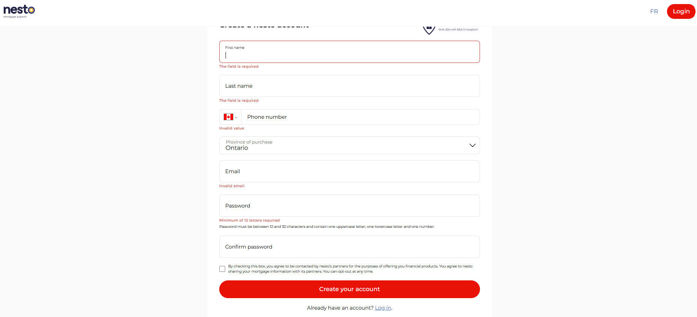
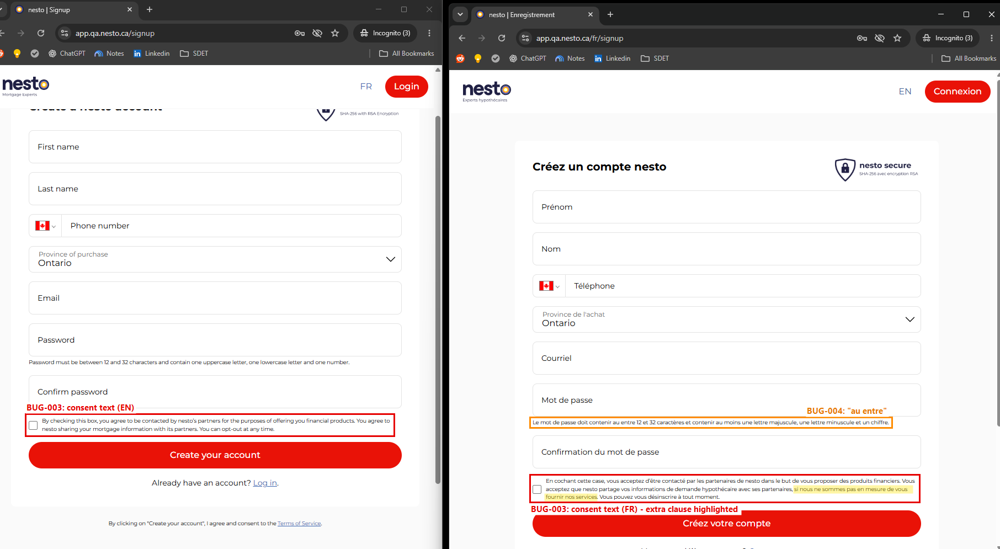
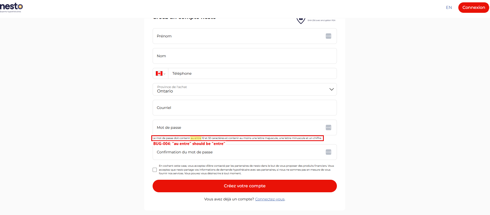
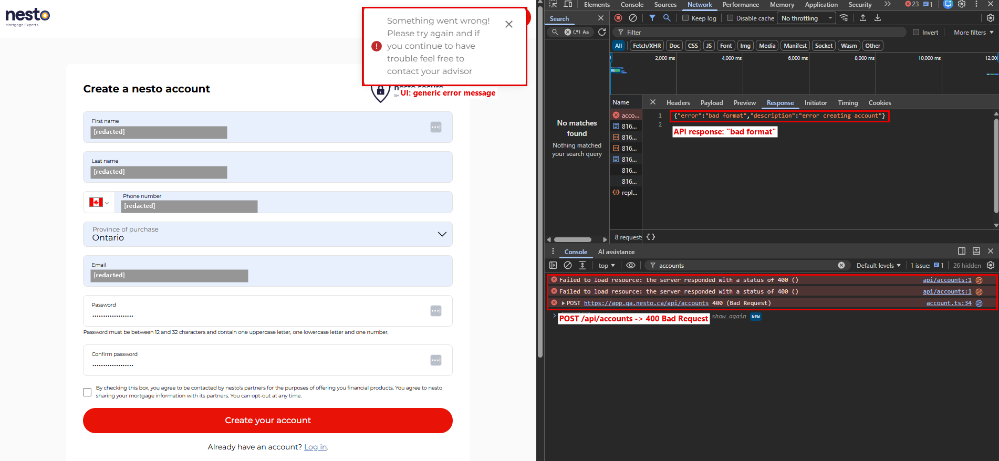

# Bug Report — nesto Signup

**Application:** nesto QA Environment  
**URL:** https://app.qa.nesto.ca/signup  
**Test Environment:** Chrome, Desktop  
**Scope:** Signup functionality, form validation, localization, and API error handling

## Summary

During functional and exploratory testing of the signup page in English and French, five potential defects were identified.

| Bug ID | Description | Severity |
|---|---|---|
| BUG-001 | Incorrect validation message for empty email | Low |
| BUG-002 | Inconsistent password validation wording | Low |
| BUG-003 | Partner-consent wording differs between English and French | Medium |
| BUG-004 | Grammatical error in French password hint | Low |
| BUG-005 | Generic error displayed for duplicate account registration | Low |

---

## BUG-001: Incorrect validation message for empty email

**Severity:** Low  
**Category:** Form Validation / UI

**Steps to reproduce:**
1. Navigate to the English signup page.
2. Leave all fields empty.
3. Click "Create your account".
4. Observe the email validation message.

**Expected Result:**

A required-field validation message should appear, consistent with the First name and Last name fields.

**Actual Result:**

The email field displays "Invalid email" instead of "The field is required".



**Impact:**

Inconsistent validation messaging may confuse users about whether the email field is empty or incorrectly formatted.

---

## BUG-002: Inconsistent password validation wording

**Severity:** Low  
**Category:** Validation / Content

**Steps to reproduce:**
1. Navigate to the English signup page.
2. Leave the password field empty.
3. Click "Create your account".
4. Compare the validation error with the password requirements displayed below the field.

**Expected Result:**

The validation message should consistently refer to a minimum of 12 characters.

**Actual Result:**

The validation error states:

"Minimum of 12 letters required"

However, the password hint states:

"Password must be between 12 and 32 characters and contain one uppercase letter, one lowercase letter and one number."

See the screenshot in BUG-001, which shows both messages together.

**Impact:**

The wording is inconsistent and may incorrectly suggest that passwords require 12 alphabetic letters rather than 12 characters.

---

## BUG-003: Inconsistent partner-consent wording between English and French

**Severity:** Medium  
**Category:** Localization / Consent

**Steps to reproduce:**
1. Navigate to the English signup page.
2. Review the consent checkbox text.
3. Switch to the French signup page.
4. Compare the consent information displayed in both languages.

**Expected Result:**

Both language versions should communicate equivalent consent conditions regarding sharing mortgage information with third-party partners.

**Actual Result:**

The French version includes the following condition:

"si nous ne sommes pas en mesure de vous fournir nos services."

Translation: "if we are unable to provide you with our services."

This condition is missing from the English version.

The French version also refers specifically to mortgage application information, while the English version refers more generally to mortgage information.



**Impact:**

English and French users may interpret the circumstances under which their information can be shared differently. Since this relates to user consent and personal financial information, the intended wording should be confirmed with the product or legal team.

---

## BUG-004: Grammatical error in French password hint

**Severity:** Low  
**Category:** Localization / Content

**Steps to reproduce:**
1. Navigate to the French signup page.
2. Locate the password field.
3. Review the password requirements displayed below the field.

**Expected Result:**

The password hint should use grammatically correct French.

Suggested wording:

"Le mot de passe doit contenir entre 12 et 32 caractères et inclure au moins une lettre majuscule, une lettre minuscule et un chiffre."

**Actual Result:**

The current message states:

"Le mot de passe doit contenir au entre 12 et 32 caractères et contenir au moins une lettre majuscule, une lettre minuscule et un chiffre."

The expression "au entre" is grammatically incorrect.



**Impact:**

Minor localization issue affecting the quality and clarity of the French signup experience.

---

## BUG-005: Generic error displayed when registering an existing account

**Severity:** Low  
**Category:** API Error Handling / User Experience

**Steps to reproduce:**
1. Successfully register a new account using valid signup information.
2. Navigate back to the signup page.
3. Attempt to register again using the same email and credentials.
4. Observe the error notification.
5. Inspect the failed `POST /api/accounts` request in the browser's Network tab.

**Expected Result:**

The application should reject the duplicate registration and provide an appropriate error response and user-facing guidance, while respecting any account-enumeration security requirements.

**Actual Result:**

The application displays the following generic notification:

"Something went wrong! Please try again and if you continue to have trouble feel free to contact your advisor"

The API returns HTTP `400 Bad Request` with the response:

```json
{
  "error": "bad format",
  "description": "error creating account"
}
```

The response describes a formatting problem rather than identifying the actual reason for registration failure.



**Impact:**

Users may interpret the failure as a temporary system problem and repeatedly attempt registration.

**Note:**

HTTP 400 is not necessarily incorrect for duplicate registration, and generic account-existence messaging may be intentional for security reasons. This finding should be reviewed against the intended API contract and account-enumeration policy.

---

## Testing Notes

- Findings were identified through manual exploratory testing of the QA environment.
- BUG-001, BUG-002, and BUG-004 concern validation consistency or displayed content.
- BUG-003 may affect the interpretation of partner-consent conditions and requires product/legal clarification.
- BUG-005 requires confirmation of the intended duplicate-registration error-handling behavior.
- These issues are documented separately from the automated regression suite. Existing tests use the current QA UI behavior as their baseline where formal expected-copy specifications were unavailable.


